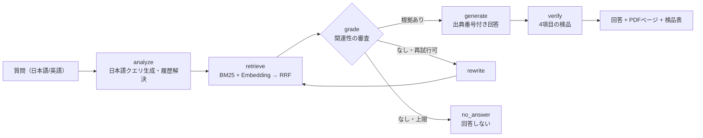
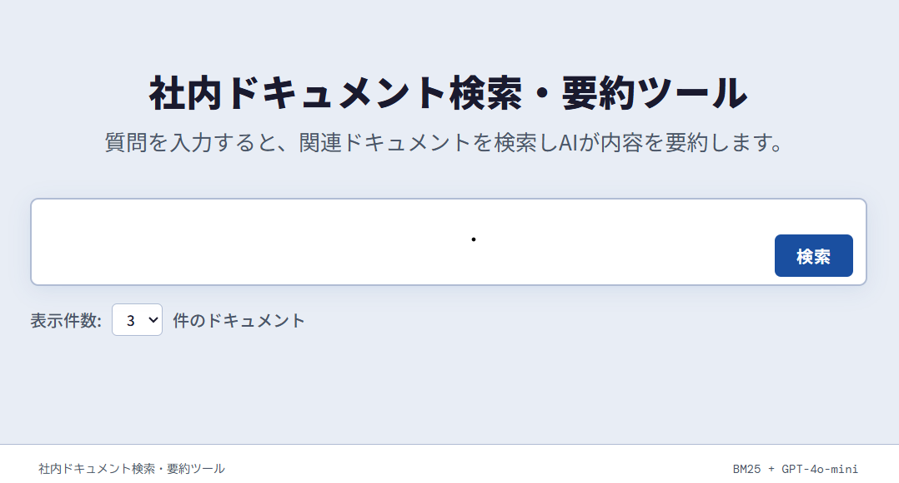
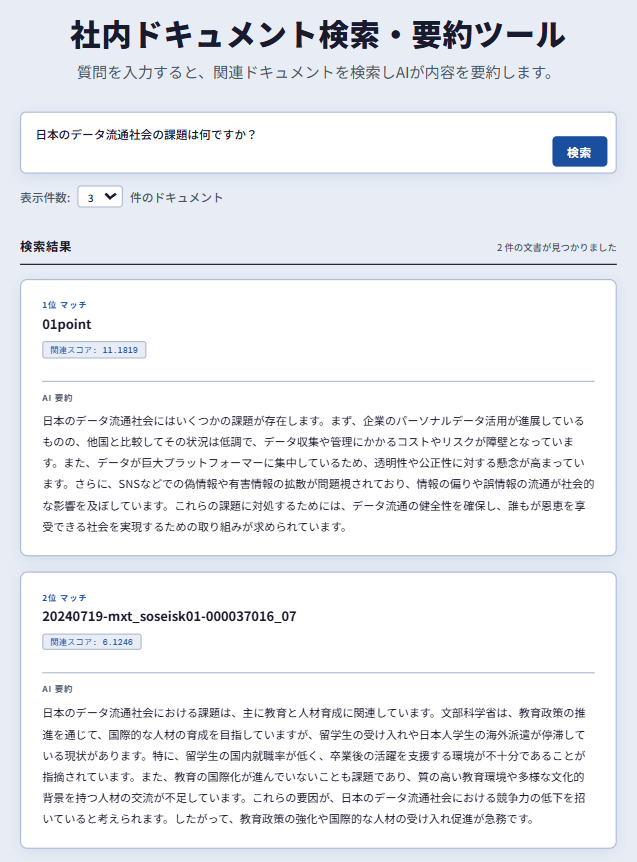

# 白書リサーチAI — 数値の誤りを「出荷前」に止める RAG エージェント

[English](README_EN.md) | **日本語**

[](https://github.com/chandinireddi/hakusho-rag-agent/actions/workflows/ci.yml)


> **一言で：** LLM が数字を1桁間違えても、ユーザーに届く前に検出して「要確認」と表示する、行政白書向けの RAG エージェントです。
> すべての文に根拠となる PDF ページを付け、資料に答えがなければ回答しません。

## はじめに

日本語または英語で質問すると、行政白書5冊を検索し、**すべての文に根拠となるPDFのページを付けて**回答するアプリです。
回答を表示する前に、工場の出荷前検査のように**4つの項目で回答を検品**します。資料に答えがない場合は、推測せずに「見つからない」と答えます。

最初は **BM25検索 ＋ GPT-4o-miniによる要約** のシンプルなアプリ（v1：[document_search_app](https://github.com/chandinireddi/document_search_app)）でした。その弱点を評価で明らかにし、**LangGraph・LangChainを使ったAIエージェント**（v2）として作り直しました。

> **なぜ「検品」なのか。** 本業では画像の品質判定AIを開発しており、AIの出力はお客様に届く前に必ず検査します。同じ考え方をLLMの回答に当てはめました。

## 全体像



---

## デモ

| エージェントの処理過程（リアルタイム表示） | 出典ページと検品結果付きの回答 |
|---|---|
|  |  |

---

## v1からv2へ

| | **v1：BM25 ＋ 要約** | **v2：LangGraph RAGエージェント** |
|---|---|---|
| 検索 | 文書全体をBM25で検索 | ページ単位のチャンクを**ハイブリッド検索**（BM25 ＋ Embedding、RRF） |
| 回答 | 先頭6,000字の要約 | 事実ごとに出典 `[1]` → PDFページ |
| 検索結果が不十分なとき | そのまま要約 | **クエリを作り直して再検索**し、それでもなければ**回答しない** |
| 数値の誤り | 確認なし | **4項目の検品**（コードによる数値照合を含む） |
| 英語・続けての質問 | キーワード一致のみ | 日本語の行政用語に変換、会話履歴に対応 |
| 他のAIツール | 不可 | **MCPサーバー**（Claude Desktop、Cursor） |

**成果：** 正しい文書を見つける精度が **0.87 → 1.00** になり、全ての評価用の質問で正解ページが上位5件に入りました。

---

## 検品の仕組み

上の「全体像」の `verify` で、次の4項目を検査します。

| 検品項目 | 見つける誤り | 方法 |
|---|---|---|
| 出典の付与 | 出典のない事実 | コード |
| 出典番号の妥当性 | 抜粋は5件なのに `[7]` と書く | コード |
| 数値照合 | `199億円` を `197億円` と書く | コード（LLM不使用） |
| 事実確認 | 抜粋にない内容 | LLMによるファクトチェック |

4項目すべてに合格した回答だけを「出典で裏付け済み」とします。

---

## どこで使えるか

- **行政の政策リサーチ：** 環境・労働・情報通信・通商・教育について質問し、ワンクリックで原文のページを確認できます。
- **社内文書の検索：** 自社のPDFを `documents/` に置いて再起動するだけです。
- **AIエージェントのツールとして：** MCPサーバーを Claude Desktop や Cursor に接続できます。
- **チャットアプリのバックエンド：** `/api/ask` または `/api/ask/stream` を呼び出します。
- **信頼できるRAGのひな形：** 数値の誤りが許されない分野（行政、医療、福祉、金融など）に活用できます。

---

## 技術スタック

| 層 | 技術 |
|---|---|
| エージェント / LLM | LangGraph、LangChain、OpenAI `gpt-4o-mini` |
| 検索 | BM25 ＋ `text-embedding-3-small`、Reciprocal Rank Fusion |
| バックエンド | Python、FastAPI、Server-Sent Events、MCP |
| フロントエンド | HTML、CSS、JavaScript |
| 品質管理 | pytest、Ruff、GitHub Actions、LangSmith（任意） |

---

## プロジェクト構成

```
hakusho-rag-agent/
├── app/
│   ├── ingest.py        # PDF → ページ単位のチャンク（キャッシュ付き）
│   ├── tokenizer.py     # 日本語・英語のトークナイザー（MeCab不要）
│   ├── retriever.py     # BM25、Embedding、RRF
│   ├── graph.py         # LangGraph エージェント ＋ 4項目の検品
│   ├── grounding.py     # 数値照合（コード）
│   ├── prompts.py       # プロンプト
│   ├── main.py          # FastAPI サーバー
│   ├── mcp_server.py    # MCP ツール
│   └── config.py, catalog.py, schemas.py
├── static/              # 画面
├── eval/                # 評価用の質問と評価スクリプト
├── tests/               # 自動テスト（オフライン）
├── documents/           # 白書PDF 5冊
├── search_results/      # スクリーンショット
```

---

## 使用した文書

公開されている日本の行政白書（2023年）：

| ファイル | 文書 | 発行 |
|---|---|---|
| `000039238.pdf` | 令和5年版 環境白書 | 環境省 |
| `001124666.pdf` | 令和5年版 厚生労働白書 | 厚生労働省 |
| `01point.pdf` | 令和5年版 情報通信白書 | 総務省 |
| `2023_gaiyo.pdf` | 通商白書2023 | 経済産業省 |
| `20240719-mxt...pdf` | 文部科学白書2023 | 文部科学省 |

各白書は、発行した省庁の公式サイトで公開されています。

---

## 評価結果

評価用の質問17問（日本語13問、英語2問、資料からは答えられない質問2問）。

<!-- EVAL:START -->
> `gpt-4o-mini` · `text-embedding-3-small` · 345 チャンク · 質問 17 件 · 2026-11-16

**検索精度**（正しい文書とページ）

| 検索方式 | DocHit@1 | Hit@1 | Hit@5 | MRR@5 |
|---|---:|---:|---:|---:|
| v1（文書単位BM25） | 0.87 | – | – | – |
| BM25（ページ単位） | 1.00 | 0.93 | 1.00 | 0.96 |

**クロスリンガル検索**（同じ質問 15 件を英語で入力し、エージェントの日本語変換を通さずそのまま検索）

| 検索方式 | DocHit@1 | Hit@1 | Hit@5 | MRR@5 |
|---|---:|---:|---:|---:|
| BM25（ページ単位） | 0.53 | 0.13 | 0.27 | 0.18 |

**数値誤りの検出** — 標準：数字を1桁変えた文 21 件 · 高難度：同じページ内の別の数字に差し替えた文 13 件

| 検証方式 | Precision | Recall | F1 | 誤検知率 | TP / FP / FN / TN |
|---|---:|---:|---:|---:|---:|
| ルールによる数値照合のみ | 1.00 | 1.00 | 1.00 | 0.00 | 21 / 0 / 0 / 21 |
| ルールによる数値照合のみ・高難度 | 0.00 | 0.00 | 0.00 | 0.00 | 0 / 0 / 13 / 13 |

_Hybrid検索・LLM判定・エージェント全体の結果は、APIキーを設定して実行すると追加されます。_
<!-- EVAL:END -->

---

## 設計判断とトレードオフ

| 判断 | 選択 | 理由 | 確認できる場所 |
|---|---|---|---|
| 日本語の分かち書き | MeCab/Sudachi ではなく NFKC ＋ 文字バイグラム | 依存ゼロで CI が軽く、固有名詞・数値も拾える | `app/tokenizer.py` |
| 検索結果の統合 | スコア加算ではなく RRF | BM25 と cosine はスケールが異なる | `app/retriever.py` |
| 数値の検証 | LLM だけに任せず、コードの照合を併用 | LLM は1桁の誤りを見逃す | `app/grounding.py`、評価表 |
| 引用の厳密さ | 検証 LLM には「引用された抜粋だけ」を渡す | 内容が正しくても出典の付け間違いを検出 | `tests/test_agent.py` |
| 障害時の挙動 | Embedding 停止時は BM25 に縮退 | 回答を止めない | `tests/test_retriever.py` |
| 根拠がないとき | 再検索し、それでもなければ回答しない | 推測で答えない | `eval/golden_set.jsonl`（neg-01/02） |

---

## 限界と今後の課題

- **数値照合の盲点：** 同じページ内の別の数字に差し替わった誤りは、コードでは検出できません。LLM 判定が補いますが、完全ではありません（高難度テストで測定）。
- **図表内の数値：** 画像として描かれたグラフの数値は取得できません。
- **評価データは小規模：** 回答可能な質問は15件のため、方式間の優劣を統計的に主張することはできません。
- **デモ用途の割り切り：** 会話履歴はメモリ上のみ（再起動で消える）で、`thread_id` の認証とレート制限はありません。

---

## データと権利

白書は各省庁が公開している資料です。利用条件は各省庁のサイトで確認してください（多くは政府標準利用規約が適用されますが、第三者の著作物を含む場合があります）。

---

## 課題と解決方法

1. **日本語PDFの文字が乱れる。** 見出しの二重表示、印刷用の記号、2段組み、全角数字がありました。`dedupe_chars()`、不要な行の除去、コンテンツ順での読み取り、NFKC正規化で解決しました。
2. **v1の要約が答えを外していた。** v1は先頭6,000字だけを使っていました。v2はページ番号付きの約500字のチャンクを検索し、関連する抜粋だけをLLMに渡します。
3. **LLMは数値を気づかれないように間違える。** 数値はコードで引用ページと照合します。1桁だけ誤った文21件のテスト（標準）では、21件すべてを検出し、誤検知は0件でした。ただし、同じページ内の別の数字に差し替わった誤りはコードだけでは検出できないため、LLM判定を併用し、高難度テストで別に測定しています。
4. **英語の質問が日本語の文書に一致しない。** 質問を日本語の行政用語に変換し（decarbonization → 脱炭素）、Embedding 検索で意味の近さでも一致させます。
5. **起動が遅い。** v1は起動ごとに約40秒かかり、キャッシュで2〜3秒に短縮しました。v2は Embedding もキャッシュし、PDFが変わると自動で作り直します。

---

## セットアップ

```bash
git clone https://github.com/chandinireddi/hakusho-rag-agent.git
cd hakusho-rag-agent
python -m venv .venv
# Windows: .venv\Scripts\activate   |   macOS/Linux: source .venv/bin/activate
pip install -r requirements.txt
cp .env.example .env               # OPENAI_API_KEY を設定
uvicorn app.main:app --reload
```

<http://localhost:8000> を開きます。初回は20〜30秒、2回目以降は2〜3秒で起動します。

```bash
pytest                                          # テスト（APIキー不要）
python -m eval.run_eval --e2e --update-readme   # 評価を実行し、結果を更新
```

---

## API

`POST /api/ask`

```json
{ "question": "学校図書館図書の整備のための地方財政措置は単年度いくらですか？" }
```

```json
{
  "answer": "学校図書館図書の整備のための地方財政措置は、単年度199億円です[1]。",
  "status": "answered",
  "citations": [{ "ref": 1, "title": "文部科学白書2023", "page": 22, "url": "/documents/…pdf#page=22" }],
  "checks": [{ "name": "数値照合（ルール）", "passed": true, "detail": "全ての数値が出典と一致" }],
  "thread_id": "…"
}
```

続けて質問するときは、同じ `thread_id` を送ります。API ドキュメント：<http://localhost:8000/docs>

**MCP（Claude Desktop / Cursor）：**

```json
{ "mcpServers": { "hakusho-research": { "command": "python", "args": ["-m", "app.mcp_server"], "cwd": "/path/to/hakusho-rag-agent" } } }
```

---

## 今後の改善

- 画像として描かれたグラフに対応する OCR や Vision モデル
- 数千文書に対応するベクトルDB（pgvector / Qdrant）
- 再起動後も会話履歴を保持
- 評価用の質問の追加