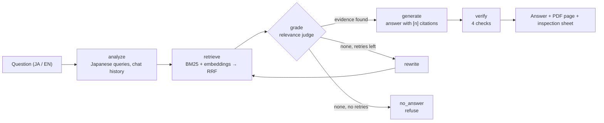
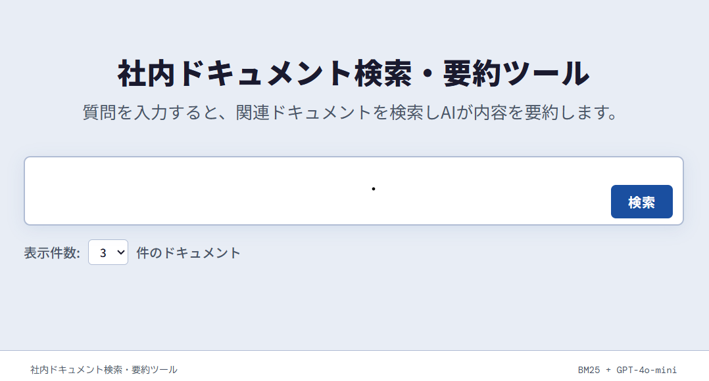
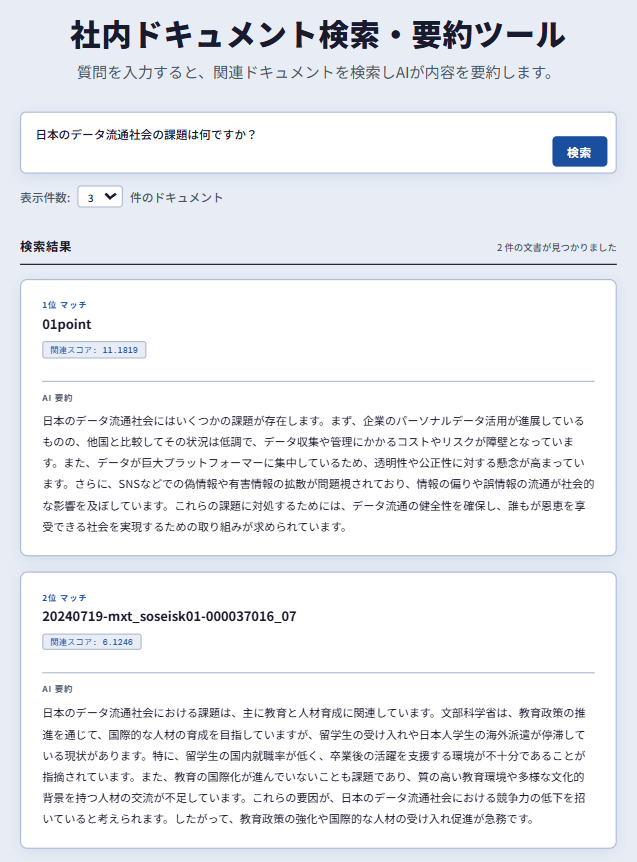

# 白書リサーチAI — A RAG Agent That Stops Wrong Numbers Before They Ship

**English** | [日本語](README.md)

[](https://github.com/chandinireddi/hakusho-rag-agent/actions/workflows/ci.yml)


> **In one sentence:** even if the LLM writes one wrong digit, this RAG agent for Japanese government white papers catches it before the user sees it and marks the answer "needs checking".
> Every sentence links to the exact PDF page, and if the documents don't contain the answer, it refuses.

## Introduction

Ask a question in Japanese or English. The app searches five Japanese government white papers and answers with **a link to the exact PDF page for every sentence**.
Before showing the answer, it **inspects it with 4 checks**, like a factory checks a product before shipping. If the documents don't contain the answer, it says so instead of guessing.

This project started as a simple **BM25 search + GPT-4o-mini summary** app (v1: [document_search_app](https://github.com/chandinireddi/document_search_app)). I measured its weak points and rebuilt it as an **AI agent with LangGraph and LangChain** (v2).

> **Why "inspection"?** In my day job I build an image quality-check AI, where every output is checked before it reaches customers. I applied the same idea to LLM answers.

## Overview



---

## Demo

| Agent steps (shown live) | Answer with page citations and check results |
|---|---|
|  |  |

---

## From v1 to v2

| | **v1: BM25 + summary** | **v2: LangGraph RAG agent** |
|---|---|---|
| Search | BM25 over whole documents | **Hybrid**: BM25 + embeddings (RRF) over page chunks |
| Answer | Summary of the first 6,000 characters | Answer with a citation `[1]` → PDF page for every fact |
| Weak search results | Summarised anyway | **Rewrites the query** and searches again, then **refuses** if still nothing |
| Wrong numbers | Not checked | **4-check inspection**, including a number check done by code |
| English / follow-up questions | Keyword match only | Translated to Japanese terms; remembers the conversation |
| Other AI tools | No | **MCP server** (Claude Desktop, Cursor) |

**Result:** finding the right document improved from **0.87 → 1.00**, and the correct page is in the top 5 for every test question.

---

## How the Inspection Works

`verify` in the overview above runs these 4 checks.

| Check | What it catches | How |
|---|---|---|
| Citations present | Facts with no source | Code |
| Citation numbers are real | LLM writes `[7]` when only 5 passages exist | Code |
| Numbers match the source | `199億円` written as `197億円` | Code (no LLM) |
| Facts are supported | Content not in the passages | LLM fact-checker |

The answer is marked **verified** only if all 4 checks pass.

---

## Where Can You Use It?

- **Policy research:** ask about the environment, labour, telecom, trade or education and check the source page in one click.
- **Company document search:** put your own PDFs in `documents/` and restart.
- **Tool for AI agents:** connect the MCP server to Claude Desktop or Cursor.
- **Backend for a chat app:** call `/api/ask` or `/api/ask/stream`.
- **Template for trustworthy RAG** in fields where a wrong number matters (public sector, healthcare, welfare, finance).

---

## Tech Stack

| Layer | Technology |
|---|---|
| Agent / LLM | LangGraph, LangChain, OpenAI `gpt-4o-mini` |
| Search | BM25 + `text-embedding-3-small`, Reciprocal Rank Fusion |
| Backend | Python, FastAPI, Server-Sent Events, MCP |
| Frontend | HTML, CSS, JavaScript |
| Quality | pytest, Ruff, GitHub Actions, LangSmith (optional) |

---

## Project Structure

```
hakusho-rag-agent/
├── app/
│   ├── ingest.py        # PDF → clean page chunks (+ cache)
│   ├── tokenizer.py     # Japanese/English tokenizer (no MeCab)
│   ├── retriever.py     # BM25, embeddings, RRF
│   ├── graph.py         # LangGraph agent + 4-check inspection
│   ├── grounding.py     # number check (code)
│   ├── prompts.py       # LLM prompts
│   ├── main.py          # FastAPI server
│   ├── mcp_server.py    # MCP tools
│   └── config.py, catalog.py, schemas.py
├── static/              # web UI
├── eval/                # test questions and evaluation
├── tests/               # automated tests (offline)
├── documents/           # five white-paper PDFs
├── search_results/      # screenshots
```

---

## Documents Used

Public Japanese government white papers (2023):

| File | Document | Publisher |
|---|---|---|
| `000039238.pdf` | 環境白書 — Environment | Ministry of the Environment |
| `001124666.pdf` | 厚生労働白書 — Health, Labour & Welfare | MHLW |
| `01point.pdf` | 情報通信白書 — Information & Communications | MIC |
| `2023_gaiyo.pdf` | 通商白書 — Trade & Industry | METI |
| `20240719-mxt...pdf` | 文部科学白書 — Education | MEXT |

Each white paper is published on its ministry's official website.

---


## Results

17 test questions (13 Japanese, 2 English, 2 that cannot be answered from the documents).

<!-- EVAL:START -->
> `gpt-4o-mini` · `text-embedding-3-small` · 345 chunks · 17 questions · 2026-11-16

**Retrieval** (correct document and page)

| Retriever | DocHit@1 | Hit@1 | Hit@5 | MRR@5 |
|---|---:|---:|---:|---:|
| v1 (whole-document BM25) | 0.87 | – | – | – |
| BM25 (page chunks) | 1.00 | 0.93 | 1.00 | 0.96 |

**Cross-lingual retrieval** (the same 15 questions typed in English, searched as-is, without the agent's translation step)

| Retriever | DocHit@1 | Hit@1 | Hit@5 | MRR@5 |
|---|---:|---:|---:|---:|
| BM25 (page chunks) | 0.53 | 0.13 | 0.27 | 0.18 |

**Number-error detection** — easy: 21 sentences with one digit changed · hard: 13 sentences where the number is swapped for another number from the same page

| Verifier | Precision | Recall | F1 | False alarm | TP / FP / FN / TN |
|---|---:|---:|---:|---:|---:|
| Rule-based number check only | 1.00 | 1.00 | 1.00 | 0.00 | 21 / 0 / 0 / 21 |
| Rule-based number check only · hard | 0.00 | 0.00 | 0.00 | 0.00 | 0 / 0 / 13 / 13 |

_Hybrid search, LLM judge and full-agent results appear after running with an API key._
<!-- EVAL:END -->

---

## Design Decisions & Trade-offs

| Decision | Choice | Why | Where to verify |
|---|---|---|---|
| Japanese tokenization | NFKC + character bigrams instead of MeCab/Sudachi | Zero dependencies, light CI, still matches names and numbers | `app/tokenizer.py` |
| Merging rankings | RRF instead of adding scores | BM25 and cosine scores are on different scales | `app/retriever.py` |
| Number verification | Code check next to the LLM judge | LLMs miss one-digit errors | `app/grounding.py`, tables above |
| Citation strictness | The judge sees only the cited passages | Catches a correct claim attached to the wrong source | `tests/test_agent.py` |
| Failure behaviour | Falls back to BM25 if embeddings fail | Keeps answering | `tests/test_retriever.py` |
| No evidence | Rewrite and retry, then refuse | No guessing | `eval/golden_set.jsonl` (neg-01/02) |

---

## Limitations

- **Number-check blind spot:** a number swapped for another number from the same page cannot be caught by code. The LLM judge covers it, but not perfectly (measured on the hard set above).
- **Charts drawn as images** are not readable.
- **Small evaluation set:** 15 answerable questions, so no statistical claims about which system is better.
- **Demo-grade operations:** conversation memory is in-process only, and there is no `thread_id` authentication or rate limiting.

---

## Data

The white papers are published by each ministry; check each ministry's terms of use (most apply the Government Standard Terms of Use, but some pages include third-party material).

---

## Challenges & Solutions

1. **Messy text from Japanese PDFs.** Doubled headings, printer marks, two-column pages and full-width numbers. Fixed with `dedupe_chars()`, line filters, reading in content order and NFKC normalisation.
2. **v1 summaries missed the answer.** v1 used only the first 6,000 characters. v2 searches ~500-character chunks with page numbers, so the LLM sees only the relevant passages.
3. **LLMs quietly change numbers.** Numbers are checked by code against the cited page. In the standard test with 21 one-digit errors, all 21 were caught with 0 false alarms. A number swapped for another number from the same page cannot be caught by code alone, so the LLM judge is used as well and measured separately on a hard set.
4. **English questions vs. Japanese documents.** The agent translates questions into Japanese government terms (decarbonization → 脱炭素), and embedding search matches by meaning.
5. **Slow startup.** v1 took ~40 seconds per start; a cache brought it to 2–3 seconds. v2 also caches embeddings and rebuilds the cache automatically when the PDFs change.

---

## Setup

```bash
git clone https://github.com/chandinireddi/hakusho-rag-agent.git
cd hakusho-rag-agent
python -m venv .venv
# Windows: .venv\Scripts\activate   |   macOS/Linux: source .venv/bin/activate
pip install -r requirements.txt
cp .env.example .env               # add your OPENAI_API_KEY
uvicorn app.main:app --reload
```

Open <http://localhost:8000>. The first start takes 20–30 seconds; after that, 2–3 seconds.

```bash
pytest                                          # tests (no API key needed)
python -m eval.run_eval --e2e --update-readme   # run the evaluation and update the results
```

---

## API

`POST /api/ask`

```json
{ "question": "学校図書館図書の整備のための地方財政措置は単年度いくらですか？" }
```

```json
{
  "answer": "学校図書館図書の整備のための地方財政措置は、単年度199億円です[1]。",
  "status": "answered",
  "citations": [{ "ref": 1, "title": "文部科学白書2023", "page": 22, "url": "/documents/…pdf#page=22" }],
  "checks": [{ "name": "数値照合（ルール）", "passed": true, "detail": "全ての数値が出典と一致" }],
  "thread_id": "…"
}
```

Send the same `thread_id` to ask a follow-up question. Full API docs: <http://localhost:8000/docs>

**MCP (Claude Desktop / Cursor):**

```json
{ "mcpServers": { "hakusho-research": { "command": "python", "args": ["-m", "app.mcp_server"], "cwd": "/path/to/hakusho-rag-agent" } } }
```

---

## Future Improvements

- OCR or a vision model for charts drawn as images
- A vector database (pgvector / Qdrant) for thousands of documents
- Saving conversation history across restarts
- More test questions